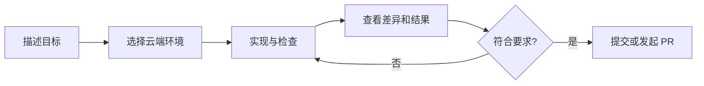

# Codex 云端使用教程

想让 Codex 在云端帮你写代码，可以先从一个小任务试起。这份教程从入口和环境配置讲起，附上能直接复制的提示词，以及把改动提交到 GitHub 的检查步骤。

> 非官方教程，核对日期：2026-11-12。不同账号和工作区的入口可能不同，请以实际界面为准。文中的提示词供练习使用，尚未逐项实测。

## 目录

- [快速开始](#快速开始)
- [把 GitHub 项目交给 Codex](#把-github-项目交给-codex)
- [配置可复用环境](#配置可复用环境)
- [实战任务怎么写](#实战任务怎么写)
- [检查并分享结果](#检查并分享结果)
- [手机与电脑接着做](#手机与电脑接着做)
- [常见问题](#常见问题)
- [旧版界面说明](#旧版界面说明)
- [资料与贡献](#资料与贡献)

## 快速开始

Codex Cloud 把编码任务放到远端执行，电脑休眠后任务仍可继续。网页或桌面端选择 **Work in → Cloud**；手机端打开 **Codex**。如果账号提供默认环境，可不选仓库先做一个小任务。[官方入门](https://learn.chatgpt.com/docs/cloud)

第一次建议复制这个提示词：

```text
写一个 Python 命令行待办工具，只使用标准库。
功能：添加待办、列出待办、标记完成；保存为本地 JSON。
请先说明文件结构，再实现，并在临时目录验证：
1. 初次运行没有数据文件；
2. 添加中文待办后重启仍能读取；
3. 完成不存在的编号时给出明确提示。
交付源代码、运行方法、实际执行的验证命令和结果。
所有示例都使用虚构数据。
```

完成后先读运行方法，检查输出文件，再追问一个小改动，例如“增加删除待办功能，并验证删除不存在的编号”。先把一个小任务做完整，再尝试大项目。



## 把 GitHub 项目交给 Codex

准备一个练习仓库，并提交至少一个 README。连接 GitHub 时确认授权的是目标账号和目标仓库，然后在环境中选择项目。云端可以检出已连接账号允许访问的仓库。[官方说明](https://learn.chatgpt.com/docs/cloud)

建议第一次先让它读项目：

```text
请检查这个仓库，先不要修改文件。
告诉我：项目用途、入口文件、依赖安装方式、现有测试和构建命令。
实际运行能执行的基础检查，区分已有失败与环境缺失。
最后推荐一个范围小、容易验收的改进任务。
```

选择任务时，把具体文件、预期行为和验收方法说清楚。例如“修复搜索框输入空格时显示全部结果的问题”，比“帮我优化项目”更容易检查。

## 配置可复用环境

新版常见入口：**Settings → Codex Cloud → Environments → Create environment**。选择仓库，让 Codex 准备依赖，检查报告后 **Publish**。更新配置后 **Republish**，再用新任务验证。每个任务拥有独立工作区；重新发布不会替换旧任务的工作状态。[环境文档](https://learn.chatgpt.com/docs/environments/cloud-environments)

配置时可以提出这些要求：

```text
请按仓库声明的版本准备运行时和包管理器。
优先依据锁文件安装依赖，报告你采用的命令。
运行项目已有的检查；说明哪些检查需要外部服务。
不要把访问凭据写进仓库、日志或示例文件。
列出尚未解决的问题，便于我检查环境能否发布。
```

网络与凭据分开排查：新版在环境设置中控制公网访问和允许域名，凭据使用环境配置中的变量或 HTTP secrets。放行域名本身不会授予服务权限。[网络与凭据配置](https://learn.chatgpt.com/docs/environments/cloud-environments#connect-to-services)

安装失败时，先记下失败命令、目标域名和错误类型，再决定是否调整配置。不要用反复重试代替诊断。具体排查顺序见 [FAQ](FAQ.md)。

## 实战任务怎么写

写任务时，说明要改什么、哪些地方不要动，以及怎样算做完。例如：

```text
背景：这是一个已有的静态个人主页。
目标：增加深色模式切换，并记住用户选择。
范围：沿用现有技术栈和样式组织方式，避免无关重构。
验收：
- 首次打开遵循系统主题；
- 手动选择后刷新仍保留；
- 按钮可以用键盘操作；
- 报告实际运行的构建与检查结果。
交付：修改说明、文件清单、验证结果、未完成项。
完成后整理成供我审阅的改动。
```

如果任务很大，拆成可分别验收的阶段，例如“数据结构 → 接口 → 页面 → 测试 → 文档”。每阶段先确认结果，再继续扩展。

更多可复制模板见 [提示词合集](prompts.md)。

## 检查并分享结果

官方建议在提交或创建 PR 前审查改动和测试结果。[任务审查说明](https://learn.chatgpt.com/docs/cloud)

推荐按以下顺序检查：

1. 浏览修改的文件，检查有没有误删、无关改动或多余依赖。
2. 用正常输入和一个异常输入实际试一次。
3. 核对测试记录，分清通过、失败和未执行的项目。缺少凭据导致的跳过也要写清楚。
4. 检查提交中有没有密钥、个人资料、临时文件或机器专用路径。
5. 创建 PR，写清修改效果、验证方法和已知限制，按仓库规则合并。

PR 描述可以这样写：

```markdown
## 修改内容
修复搜索框只输入空格时显示全部结果的问题。
现在会提示输入关键词。

## 验证
- 正常关键词：能够搜索。
- 空字符串及纯空格：显示提示。
- 项目检查：填写实际执行的命令与结果。

## 已知限制
填写尚未验证的场景；没有则明确写无已知项。
```

GitHub 上有源码，并不等于网站已经上线。需要在线访问时，再按项目使用的托管平台配置构建、环境变量和部署，并打开正式地址检查。

## 手机与电脑接着做

换设备时重新打开**同一个任务**继续；新建任务会使用自己的工作区。重要代码及时提交，所需输出另行保存。[跨设备与状态说明](https://learn.chatgpt.com/docs/environments/cloud-environments#run-and-return-to-a-task)

找不到任务时，建议记录标题、链接、创建时间，并逐项检查：账号是否相同、工作区是否相同、打开的是否为云端任务入口、是否有筛选或归档。这个顺序是排查建议，不代表官方保证任务一定能在每个列表中出现。

## 常见问题

| 问题 | 先检查什么 |
| --- | --- |
| 没有 Cloud 入口 | 当前账号、工作区权限和实际可用功能 |
| 仓库找不到 | GitHub 连接的账号及目标仓库授权 |
| 安装依赖失败 | 第一条失败命令、运行时版本、锁文件、下载域名 |
| 能联网却认证失败 | 服务权限和凭据配置，避免只改网络开关 |
| 更新环境后旧任务没变 | 用新任务验证重新发布的环境 |
| 代码改好了但 GitHub 没变 | 是否已提交并推送，或已创建并合并 PR |
| 手机发起后电脑找不到 | 同一账号、工作区、任务链接和筛选条件 |

详细步骤见 [常见问题与排查](FAQ.md)。

## 旧版界面说明

如果看到 setup script、maintenance script、Agent internet access 等选项，请核对是否为 **Codex Cloud (Legacy)**。官方仍为 Code Review 和 Linear/GitHub 集成保留相关说明。旧版 agent 阶段默认关闭联网，setup 阶段可联网；旧版 Secrets 的可用阶段也与新版机制不同。不要直接套用新版配置步骤。[Legacy 环境](https://learn.chatgpt.com/docs/environments/cloud-environment) · [Legacy 网络设置](https://learn.chatgpt.com/docs/cloud/internet-access)

## 资料与贡献

- [Codex Cloud 官方入门](https://learn.chatgpt.com/docs/cloud)
- [新版云端环境](https://learn.chatgpt.com/docs/environments/cloud-environments)
- [Legacy 环境](https://learn.chatgpt.com/docs/environments/cloud-environment)
- [Legacy 网络](https://learn.chatgpt.com/docs/cloud/internet-access)
- [提示词合集](prompts.md)
- [贡献说明](CONTRIBUTING.md)
- [更新记录](CHANGELOG.md)

排版参考了 [OpenAI Cookbook](https://github.com/openai/openai-cookbook) 的项目介绍、示例入口和资料链接组织方式，正文独立编写。发现界面或步骤有变化，可以提交 Issue，附入口名称、复现步骤和官方资料链接；截图请先脱敏。
